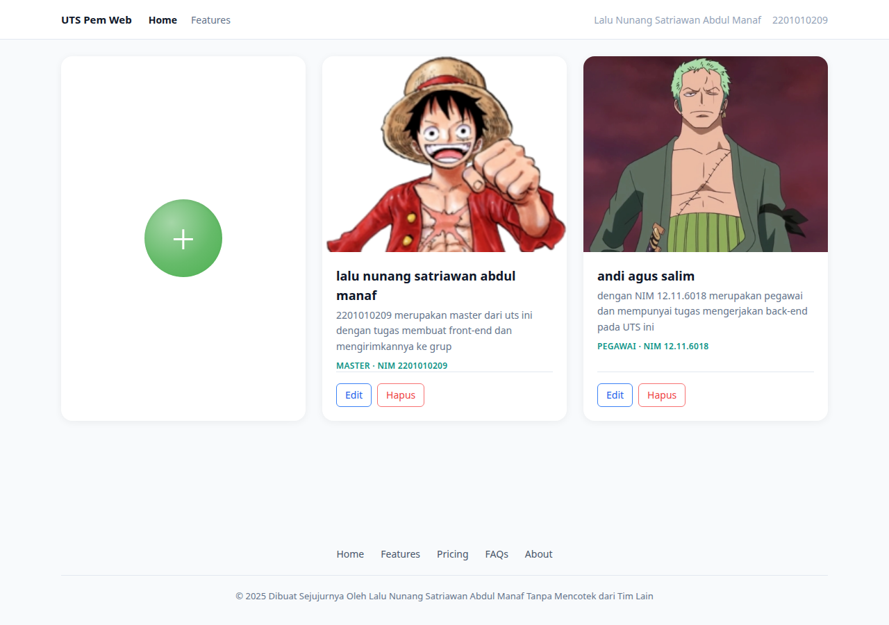
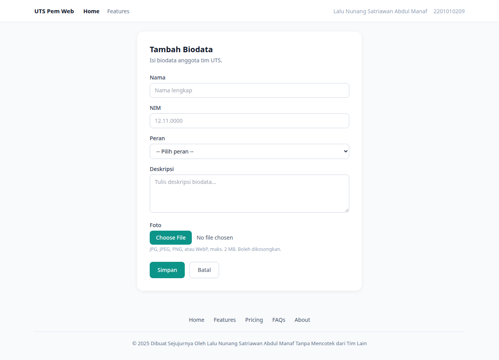
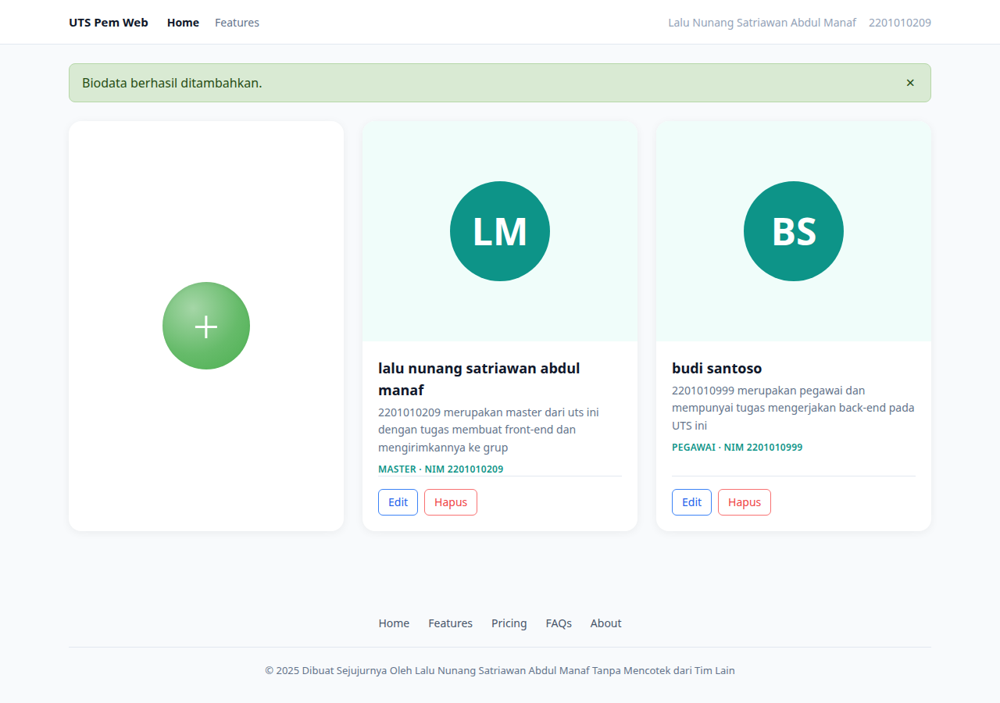
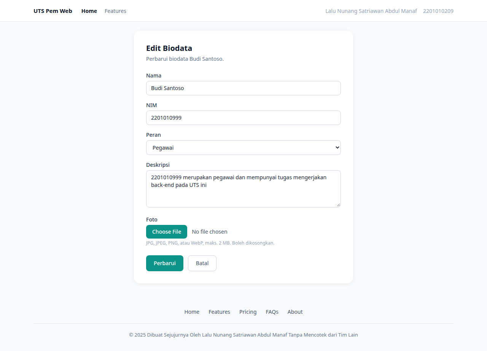
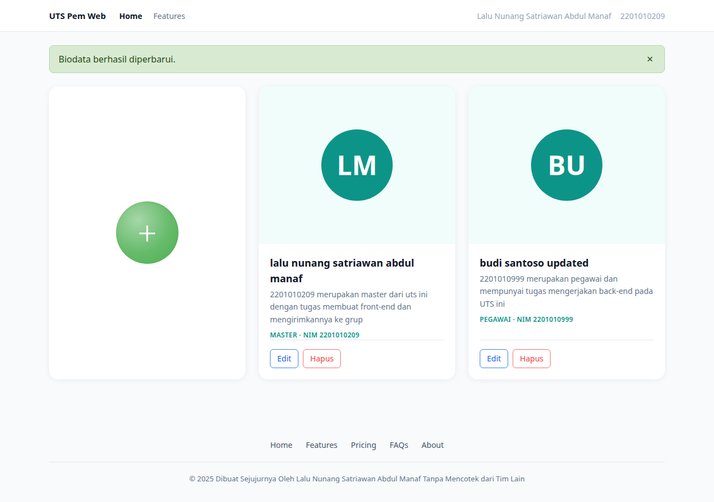
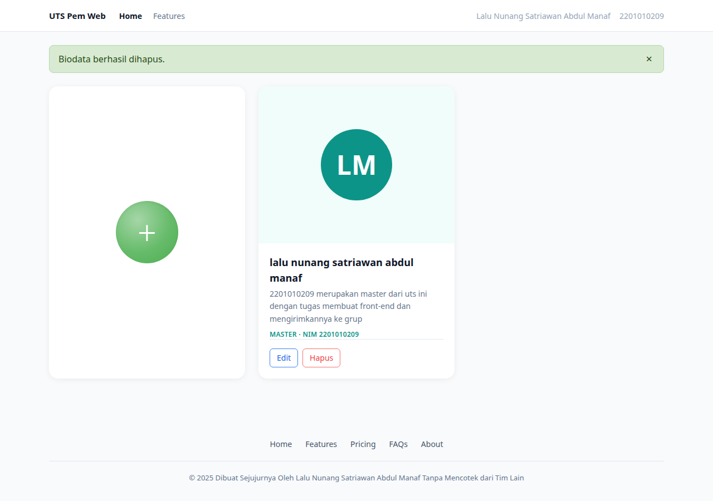
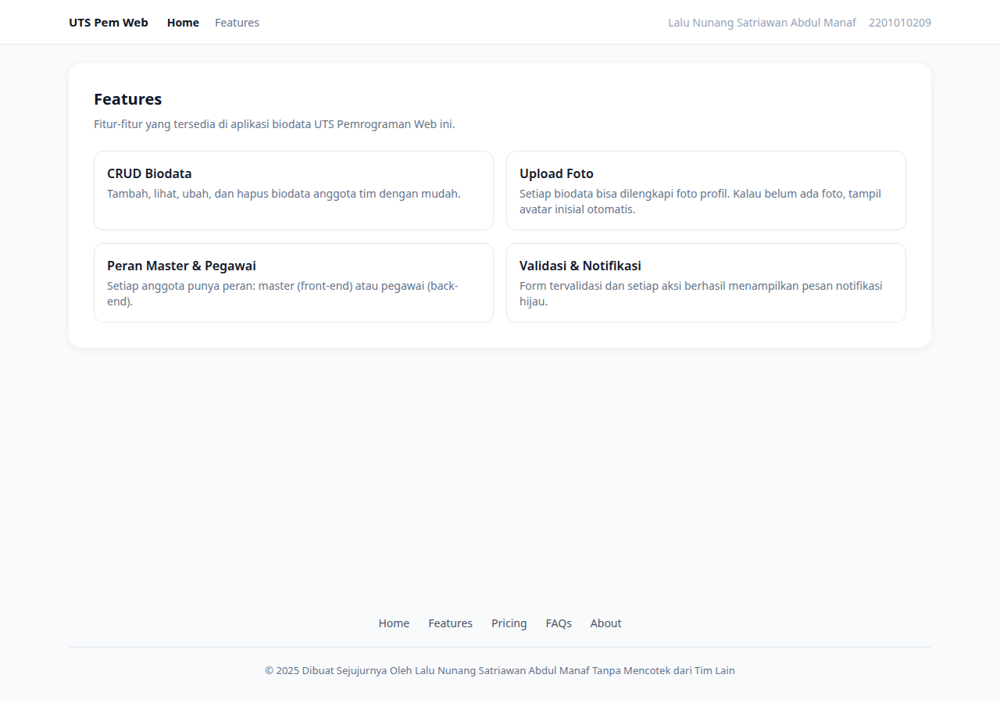
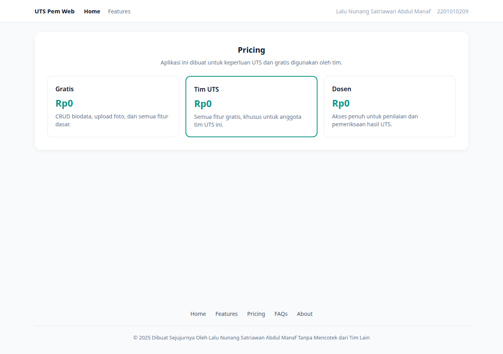
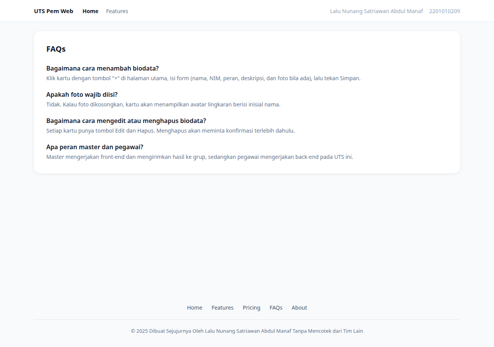
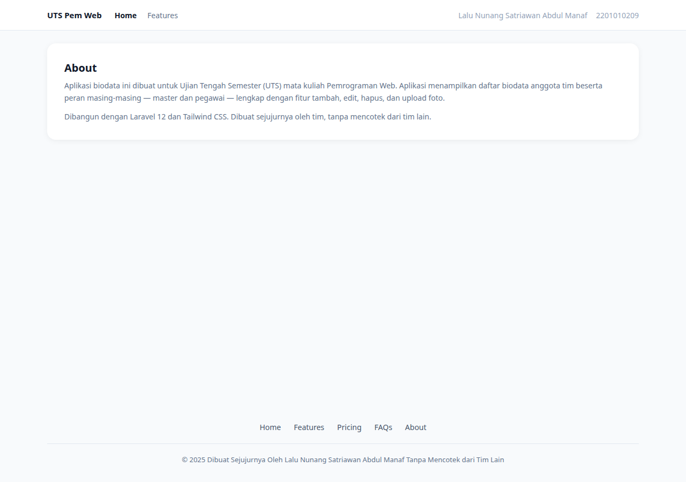

# UTS Pem Web — Aplikasi Biodata Tim

Aplikasi CRUD biodata anggota tim untuk Ujian Tengah Semester (UTS) mata kuliah
Pemrograman Web. Dibangun dengan **Laravel 12** + **Tailwind CSS** (file lokal di
`public/js/tailwind.js`, tanpa CDN — tetap rapi walau dibuka tanpa internet),
tampilan mengikuti gambar referensi `buat seperti ini.png` dengan style ringan
ala Catatan Ryns (background abu sangat muda, kartu putih rounded-2xl, aksen teal).

## Tampilan aplikasi

### Halaman utama — kartu "+" dan kartu biodata (foto Luffy & Zoro)



### Form tambah biodata (klik kartu "+")



### Alert setelah tambah — "Biodata berhasil ditambahkan."



### Form edit biodata



### Alert setelah edit — "Biodata berhasil diperbarui."



### Alert setelah hapus — "Biodata berhasil dihapus."



### Halaman Features



### Halaman Pricing



### Halaman FAQs



### Halaman About



## Fitur

- **CRUD biodata** — tambah, lihat, ubah, dan hapus biodata anggota tim.
- **Upload foto** — foto profil disimpan di `storage/app/public/biodata`. Kalau
  biodata belum punya foto, kartu menampilkan avatar lingkaran berisi inisial nama.
- **Peran master & pegawai** — master mengerjakan front-end, pegawai back-end.
- **Validasi form** — nama, NIM, peran, dan deskripsi wajib diisi.
- **Flash message** — "Biodata berhasil ditambahkan." / "Biodata berhasil
  diperbarui." / "Biodata berhasil dihapus." setelah tiap aksi.
- **Halaman statis** — Features, Pricing, FAQs, About dengan layout yang sama.
- **Nama & NIM tim di navbar** — diatur lewat `TEAM_NAME` / `TEAM_NIM` di `.env`.

## Cara menjalankan

```bash
cp .env.example .env
php artisan key:generate
php artisan migrate --seed
php artisan storage:link
php artisan serve
```

Lalu buka http://localhost:8000.

## Data awal (seeder)

| Nama | NIM | Peran |
| --- | --- | --- |
| Lalu Nunang Satriawan Abdul Manaf | 2201010209 | master |
| Andi Agus Salim | 12.11.6018 | pegawai |

Foto kartu memakai gambar karakter One Piece (Luffy untuk master, Zoro untuk
pegawai) sebagai pengganti foto orang. Kartu pegawai (Andi Agus Salim) memakai
data contoh dari gambar referensi — UTS ini sebenarnya dikerjakan sendirian,
jadi kartu tersebut bisa dihapus lewat tombol **Hapus** atau diubah lewat
**Edit**.

## Daftar route

| Method | URI | Keterangan |
| --- | --- | --- |
| GET | `/` | Beranda — daftar kartu biodata |
| GET | `/features` | Halaman Features |
| GET | `/pricing` | Halaman Pricing |
| GET | `/faqs` | Halaman FAQs |
| GET | `/about` | Halaman About |
| GET | `/biodata/create` | Form tambah biodata |
| POST | `/biodata` | Simpan biodata baru |
| GET | `/biodata/{id}/edit` | Form edit biodata |
| PUT | `/biodata/{id}` | Perbarui biodata |
| DELETE | `/biodata/{id}` | Hapus biodata (dengan konfirmasi) |

## Struktur penting

- `app/Models/Biodata.php` — model + helper inisial avatar
- `app/Http/Controllers/BiodataController.php` — logika CRUD
- `database/migrations/2026_11_25_000001_create_biodatas_table.php`
- `database/seeders/BiodataSeeder.php`
- `resources/views/layouts/app.blade.php` — navbar, flash message, footer
- `resources/views/biodata/` — `index`, `create`, `edit`, `_form`
- `resources/views/pages/` — `features`, `pricing`, `faqs`, `about`

## Teknologi

- Laravel 12 (PHP 8.3), SQLite
- Tailwind CSS (file lokal `public/js/tailwind.js`, tanpa CDN dan tanpa build step)
- Tidak ada auth — sesuai kebutuhan UTS.
